<div align="center">


# RepoMind

**Turn the free DeepSeek web chat into a real software-engineering workflow.**

RepoMind is a Chrome extension plus a small local companion that gives DeepSeek repository awareness,
a plan → implement → verify discipline, patch safety checks, real build/test feedback, project memory
— and can publish DeepSeek's code straight to your GitHub repository.

[](https://github.com/cyb3rl00m/repo-mind/releases/latest)
[](LICENSE)
-informational)


[Install](#-installation) · [Quick start](#-quick-start) · [Features](#-features) · [How it works](#-how-it-works) · [Safety](#-safety--privacy) · [FAQ](#-faq)

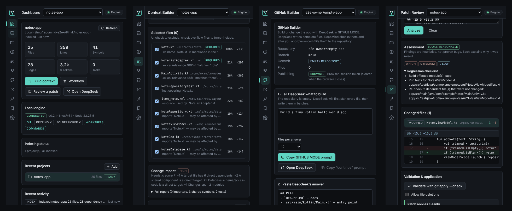

</div>

---

## Why RepoMind?

Free chat models are good at writing code, but working on a *real* repository through a chat window goes wrong in predictable ways:

| Problem when you chat with DeepSeek directly | What RepoMind does about it |
|---|---|
| It only sees the files you remembered to paste | Indexes the whole repository and **picks the relevant files for you**, with reasons |
| It doesn't know what else a change affects | Builds a dependency graph and writes a **Change Impact Report** into the prompt |
| It jumps straight into code and forgets requirements | Enforces **Understand → Plan (you approve) → Implement → Review → Verify → Correct** |
| It breaks working code, invents imports, writes `// ... rest of code` | **Patch Review** catches removed functions, changed signatures, broken imports, placeholders and schema changes before anything is applied |
| It claims code compiles without running it | **Build & Test** runs your real build/tests (with your approval) and feeds the actual errors back |
| It forgets decisions between chats | **Project Memory** puts approved facts and decisions at the top of every prompt |
| Copying 15 generated files into a repo by hand | **GitHub Builder** puts DeepSeek in **GITHUB MODE** and commits its files to your repository in one click |

RepoMind **never calls an AI API**, never automates or scrapes the DeepSeek website, and never sends anything anywhere without you clicking a button. You copy prompts into DeepSeek and paste answers back — RepoMind does the engineering around it.

> RepoMind does not change DeepSeek's model. It improves what the model sees and checks what it produces. It does not promise results equal to any other model.

---

## 📦 Installation

RepoMind runs on **any modern Linux distribution** — Arch, CachyOS, Manjaro, EndeavourOS, Debian, Ubuntu, Linux Mint, Pop!_OS, Zorin, elementary, Fedora, Nobara, openSUSE and others. It has two parts:

- **Chrome extension** — the user interface (a side panel). Works in Google Chrome, Chromium, Brave, Vivaldi and Microsoft Edge.
- **Local engine** — a small Node.js program that the extension talks to through Chrome *Native Messaging*. It is needed for local folders, git checkpoints, applying patches, running builds and storing your GitHub token in the system keyring. GitHub import, prompts and GitHub Builder also work without it.

<!-- install:start -->
### Requirements

| | Needed | Why |
|---|---|---|
| **Node.js 20 or newer** | yes | runs the local engine (`node --version` must print `v20` or higher) |
| **git** | yes | patches, checkpoints, worktrees |
| **A natively installed Chromium-based browser** | yes | Chrome, Chromium, Brave, Vivaldi or Edge from a `.deb`/`.rpm`/AUR/distro package — **not Snap or Flatpak** (see below) |
| `secret-tool` (libsecret) | optional | keeps your GitHub token in the system keyring |
| `kdialog` or `zenity` | optional | native "pick a folder" dialog |
| JDK + Android SDK | optional | only for running Android/Gradle builds from RepoMind |

### Step 1 — install the dependencies for your distribution

Pick your distribution, run its commands, then continue with step 2. Nothing in RepoMind itself needs `sudo`.

<details open>
<summary><b>Arch Linux · CachyOS · Manjaro · EndeavourOS · Garuda</b></summary>

```bash
sudo pacman -S --needed nodejs git
sudo pacman -S --needed libsecret kdialog      # optional (use zenity instead of kdialog on GNOME)
```
</details>

<details>
<summary><b>Ubuntu · Debian · Linux Mint · Pop!_OS · Zorin OS · elementary OS</b></summary>

```bash
sudo apt update
sudo apt install -y nodejs git curl
sudo apt install -y libsecret-tools zenity     # optional (kdialog instead of zenity on KDE)
node --version
```

If `node --version` prints **v18 or lower** (Debian 12, Ubuntu 22.04/24.04, Mint 21/22 ship old versions), install a current Node.js from NodeSource and check again:

```bash
curl -fsSL https://deb.nodesource.com/setup_22.x -o /tmp/nodesource_setup.sh
sudo bash /tmp/nodesource_setup.sh
sudo apt install -y nodejs
node --version                                 # should now print v22.x
```

Ubuntu's default **Chromium is a Snap** and can't start the engine — install **Google Chrome** (`.deb` from google.com/chrome) or Brave/Vivaldi from their `.deb` repositories.
</details>

<details>
<summary><b>Fedora · Nobara · Ultramarine</b></summary>

```bash
sudo dnf install -y nodejs git
sudo dnf install -y libsecret zenity           # optional (kdialog instead of zenity on KDE spins)
node --version                                 # Fedora 40+ ships Node 20 or newer
```

Fedora's `chromium` package from the official repositories works. Google Chrome: enable it under *Software → Third-party repositories* or install the `.rpm` from google.com/chrome.
</details>

<details>
<summary><b>openSUSE Tumbleweed · Leap</b></summary>

```bash
sudo zypper install nodejs22 git               # Leap: nodejs20 also works
sudo zypper install secret-tool zenity         # optional (kdialog instead of zenity on KDE)
node --version
```
</details>

<details>
<summary><b>Other distributions (Void, Gentoo, NixOS, Alpine, Solus, …)</b></summary>

Install **Node.js 20+** and **git** with your package manager, or Node.js from <https://nodejs.org/en/download> (prebuilt binaries or [nvm](https://github.com/nvm-sh/nvm) — the installer records the absolute path of the `node` you use). Optional: the package that provides the `secret-tool` command, and `kdialog` or `zenity`.

The installer needs `bash`, `curl`/`tar` and a home directory that follows the usual layout (`~/.config`, `~/.local/share`). On NixOS, run it from a shell where `node` is on `PATH`.
</details>

### Step 2 — download and install RepoMind (same on every distribution)

```bash
curl -L -o /tmp/repomind.tar.gz https://github.com/cyb3rl00m/repo-mind/releases/latest/download/repomind-prebuilt.tar.gz
tar -xzf /tmp/repomind.tar.gz -C ~             # creates ~/repomind
cd ~/repomind
./scripts/install.sh --no-build                # installs the engine for your user (never uses sudo)
node scripts/selftest.mjs                      # optional: checks engine, git integration, Gradle detection
```

You can also download `repomind-prebuilt.tar.gz` from the [Releases page](https://github.com/cyb3rl00m/repo-mind/releases/latest) and extract it to your home folder with your file manager.

The installer:

- checks Node.js ≥ 20 and git and prints the right install command for **your** package manager (pacman, apt, dnf or zypper) if something is missing;
- copies the engine to `~/.local/share/repomind/engine/` with a launcher that pins your Node path, and links `~/.local/bin/repomind-engine`;
- registers the Native Messaging host for every Chromium-based browser profile it finds (Chrome, Chrome Beta/Dev, Chromium, Brave, Vivaldi, Edge). If the browser has never been started yet, start it once or force it with `./scripts/install.sh --no-build --browser chrome` (or `chromium`, `brave`, `vivaldi`, `edge`, `all`);
- warns you if it sees a Snap or Flatpak browser;
- runs `repomind-engine --doctor`.

### Step 3 — load the extension

1. Open `chrome://extensions` (Brave: `brave://extensions`, Vivaldi: `vivaldi://extensions`, Edge: `edge://extensions`).
2. Turn on **Developer mode** (top right).
3. Click **Load unpacked** and select the folder `~/repomind/packages/extension/dist`.
4. Check that the ID is **`ddblnfbnekcpcpnnbeioffideiikfgmp`** — the engine only accepts this ID.
5. Pin the RepoMind icon and click it. The side panel opens and the **Engine** pill in the top-right turns green.

> **Keep the `~/repomind` folder.** The browser loads the extension from it. The engine itself is copied to `~/.local/share/repomind/engine`.

### Browser compatibility

| Browser | Works? |
|---|---|
| Google Chrome (`.deb` / `.rpm` / AUR `google-chrome`) | ✅ |
| Chromium from Arch, Fedora, openSUSE, Debian (`apt install chromium`) | ✅ |
| Brave, Vivaldi, Microsoft Edge (native packages) | ✅ |
| **Snap** Chromium (Ubuntu's default `chromium`) | ⚠️ extension loads, but the sandbox blocks the local engine (no local folders, patching or builds) |
| **Flatpak** Chrome / Chromium / Brave | ⚠️ same limitation as Snap |
| Firefox | ❌ not supported (Chrome extension) |

### Updating

```bash
curl -L -o /tmp/repomind.tar.gz https://github.com/cyb3rl00m/repo-mind/releases/latest/download/repomind-prebuilt.tar.gz
rm -rf ~/repomind && tar -xzf /tmp/repomind.tar.gz -C ~
cd ~/repomind && ./scripts/install.sh --no-build
```

Then press the reload icon on RepoMind in `chrome://extensions`. Your projects, memory and tasks are kept (they live in the browser profile).

### Uninstalling

```bash
~/repomind/scripts/uninstall.sh            # engine + browser registrations
~/repomind/scripts/uninstall.sh --purge    # also config and logs
```

Then remove the extension in `chrome://extensions`.
<!-- install:end -->

### Building from source instead

Needs `npm` as well (`pacman -S npm` · `apt install npm` · `dnf install npm` · `zypper install npm22`; NodeSource's `nodejs` already contains npm).

```bash
git clone https://github.com/cyb3rl00m/repo-mind.git ~/repomind
cd ~/repomind
./scripts/install.sh            # runs npm ci + npm run build, then installs
```

Full details and troubleshooting: [INSTALLATION.md](INSTALLATION.md).

---

## ⚙️ Setup

### GitHub token (private repos and publishing)

Public repositories import without a token. You need one to import **private** repositories or to **publish** with GitHub Builder.

1. Open **[GitHub → Fine-grained tokens → Generate new token](https://github.com/settings/personal-access-tokens/new)**.
2. **Repository access:** *Only select repositories* → pick the repositories RepoMind should use.
3. **Permissions → Repository permissions:**
   - **Metadata:** Read-only (always required)
   - **Contents:** *Read-only* to import, or **Read and write** to publish with GitHub Builder
4. Generate, copy, and paste it into RepoMind → **Settings → GitHub access**:
   - **Store in keyring** — when the engine is connected and `libsecret` is installed (KWallet with Secret Service, or GNOME Keyring). The token never touches browser storage.
   - **Use for this session** — otherwise. Kept in memory only; gone when the browser closes.

Tokens never appear in prompts, exports or logs. Removing a token in RepoMind does not revoke it; revoke it on GitHub.

### Android builds (optional)

Build & Test runs `./gradlew …` in your project. Chrome starts the engine without your shell's environment, so the engine imports your login-shell environment once. If Gradle still can't find the SDK, set it explicitly in `~/.config/repomind/engine.json`:

```json
{ "env": { "ANDROID_HOME": "/home/you/Android/Sdk", "JAVA_HOME": "/usr/lib/jvm/java-17-openjdk" } }
```

---

## 🚀 Quick start

### A) Build a new app in an empty GitHub repository

1. Create an empty repository on GitHub and a token with **Contents: Read and write** for it (see [Setup](#github-token-private-repos-and-publishing)).
2. **Repositories** → paste `https://github.com/you/your-repo` → **Import & index** (empty repositories import with 0 files).
3. **GitHub Builder** → describe the app → **Copy GITHUB MODE prompt** → paste into [DeepSeek](https://chat.deepseek.com/).
4. Copy DeepSeek's **whole** answer → paste it into step 2 → **Check files**.
5. Review the file list and previews → **Publish** → confirm. The files are now one commit on GitHub.
6. **Copy "continue" prompt** → DeepSeek writes the next batch → check → publish. Repeat until DeepSeek reports `REMAINING: NONE`.

### B) Change an existing local project (e.g. an Android app)

1. **Repositories** → *Open a local folder* → pick your project (e.g. `~/AndroidStudioProjects/MyApp`).
2. **Context Builder** → describe the change → **Find relevant code** → check files, budget and impact → **Start workflow task**.
3. **Workflow** → *Generate & copy* the **Understand** prompt → DeepSeek → paste the answer back. Same for **Plan**, then **Approve plan**.
4. **Implement** → paste DeepSeek's diff → RepoMind opens **Patch Review** → *Validate with git apply --check* → **Apply** (a git checkpoint is created first).
5. **Build & Test** → run `./gradlew assembleDebug` / `test` after confirming. Failures become a **Correct** prompt with the real compiler output.
6. **Complete** → an evidence-based report; add decisions to Memory.

---

## ✨ Features

RepoMind lives in the browser side panel (or a full tab via the ▭ icon at the bottom of the left bar). The screenshots below come from the automated end-to-end test.

<table>
<tr>
<td width="55%" valign="top">

### 🏠 Dashboard

The active project at a glance: files, lines, symbols, dependency edges, estimated tokens and tasks. Engine status and capabilities, indexing status, recent projects and an activity log. Quick buttons for Context Builder, Workflow, Patch Review, GitHub Builder and DeepSeek.

</td>
<td width="45%">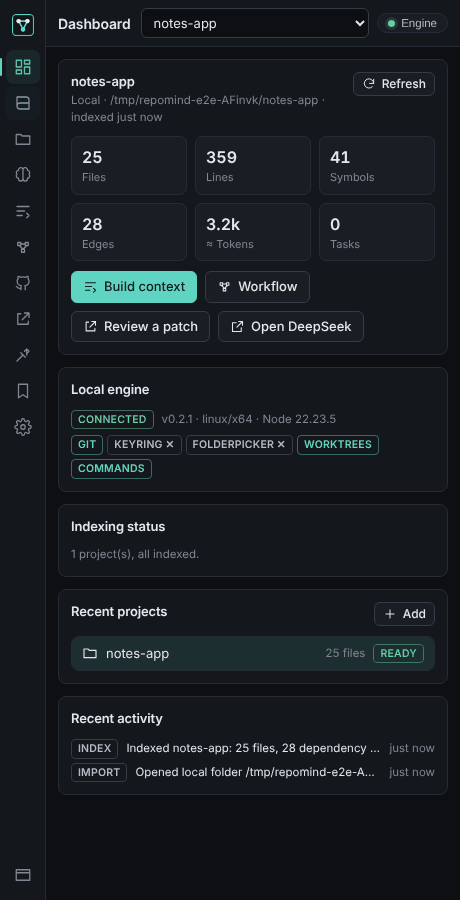</td>
</tr>
<tr>
<td valign="top">

### 📁 Repositories

- **GitHub import** — `https://github.com/owner/repo`, `owner/repo`, `git@github.com:…`, even `…/tree/branch/sub/folder`. One zip download per snapshot (fits GitHub's 60 requests/hour limit). Public, private (token) and **empty** repositories.
- **Branch switching** and refresh to the latest commit.
- **Local folders** through the engine (folder picker or path) — live files and git branch/commit/dirty files.
- **Browser folder** (read-only, no engine needed).
- **Isolated worktrees** — create `repomind/<name>` branches in a separate checkout so AI patches never touch your main checkout.

</td>
<td>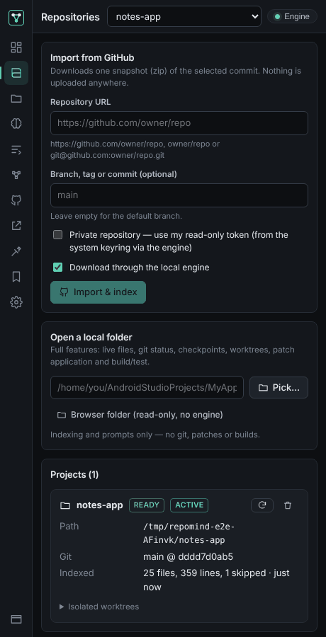</td>
</tr>
<tr>
<td valign="top">

### 🔎 Explorer

File tree and search across files **and symbols**. For each file: language, role, module, size, token estimate, parser fidelity, every class/function/method with line numbers, *Depends on* and *Used by* lists, unresolved imports, secret and prompt-injection warnings, and the full source. **Include / Exclude** pins a file into (or out of) every prompt.

</td>
<td>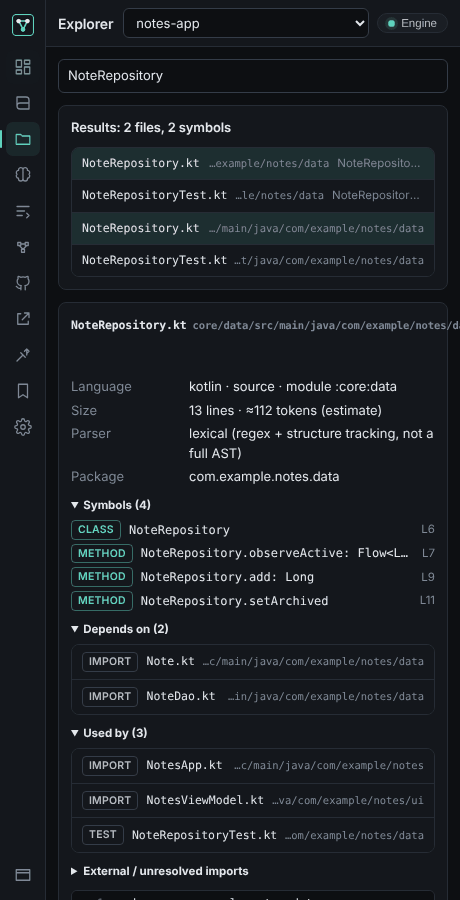</td>
</tr>
<tr>
<td valign="top">

### 🧠 Project Brain

- **Architecture:** detected stack (Android, Compose, Room, Hilt, Retrofit, React, Django, Tokio, …), languages, file roles and an honest list of **index limitations**.
- **Module graph:** Gradle / npm / Cargo / Go modules and their dependencies, drawn as a graph.
- **Dependencies:** the most-depended-on files (shared components) and each file's neighbours.
- **Entry points:** launcher activity, manifest components, `main` functions, package entries.
- **Configuration map:** Gradle files, version catalog, manifest, package.json, CI, lint rules.

</td>
<td>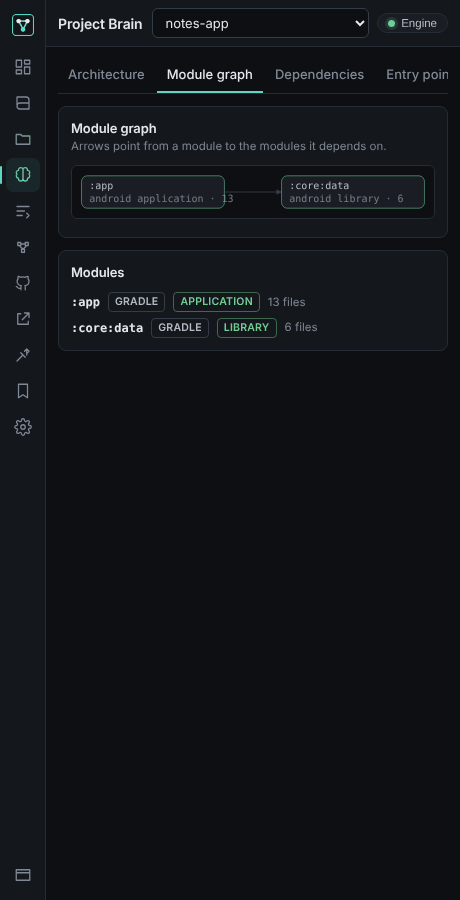</td>
</tr>
<tr>
<td valign="top">

### 🎯 Context Builder

Describe a task and RepoMind ranks files: BM25 search over paths, symbols and code, plus developer synonyms, plus the dependency graph (imports, importers, tests, build files). Every file shows **why** it was chosen, its relevance and estimated tokens.

- **Context budget** with estimated tokens and characters. Required dependencies are never dropped silently: they are shrunk to *outlines* or flagged, with **Split into multiple packages**.
- **Change Impact Report** with a **LOW / MODERATE / HIGH / CRITICAL** risk and the exact factors behind it.
- **8 engineering modes** with stage-specific prompts; **Copy to DeepSeek**, **Export .md**, **Start workflow task**.

</td>
<td>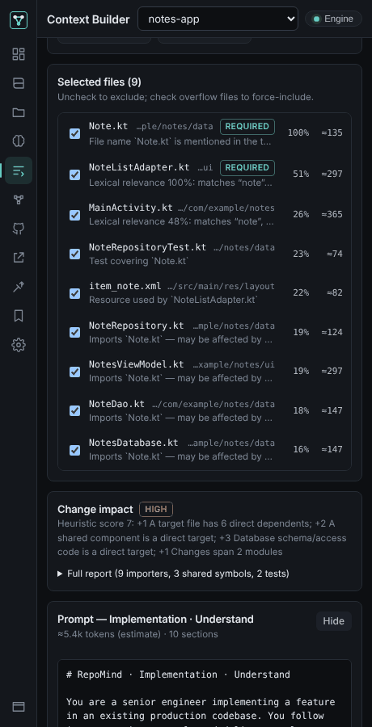</td>
</tr>
<tr>
<td valign="top">

### 🔁 Workflow

Structured tasks: **Understand → Plan → Implement → Review → Verify → Correct → Complete**. Each stage generates its own prompt, stores DeepSeek's answer, and moves forward only when you say so.

- **Plan** answers are parsed into files, implementation units and acceptance criteria; you **approve** the plan before any code is requested.
- **Implement / Correct** answers become patches for Patch Review.
- **Correct** prompts contain the real compiler/test output and the *current* version of the failing files; attempts are counted.
- **Complete** produces a report built only from recorded evidence — nothing counts as verified unless a command actually passed.

</td>
<td>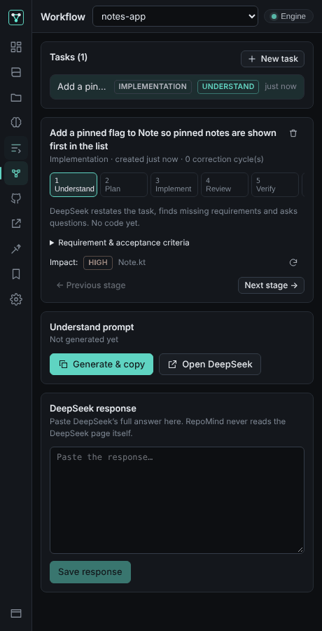</td>
</tr>
<tr>
<td valign="top">

### 🐙 GitHub Builder — GITHUB MODE

Build or change an app on GitHub without copying files by hand.

1. **Copy GITHUB MODE prompt** — tells DeepSeek to output complete files in a strict format (`=== FILE: path`, `TYPE`, `ACTION: CREATE/UPDATE/DELETE`, code block) and to end with a status block (`BATCH`, `DONE`, `REMAINING`, `MANUAL STEPS`). It includes the repository tree, project memory and the relevant existing files. For an empty repository DeepSeek first writes a **PLAN** of every file.
2. **Paste the answer → Check files** — every file is validated: elided code (`// ... rest of the code`), cut-off answers, unsafe paths, `.git/`, secret files, binaries, embedded API keys. Rejected files can't be selected. Updates show a **diff** against the current file.
3. **Publish** — one commit on your branch, or on a **new branch** to review as a pull request. Fast-forward only, never force-pushes, and stops if the branch changed on GitHub in the meantime.
4. **Continue** — the *continue* prompt lists what is published and what is REMAINING; *fix and resend* asks DeepSeek to redo rejected files.

For local-folder projects the files go to Patch Review instead.

</td>
<td>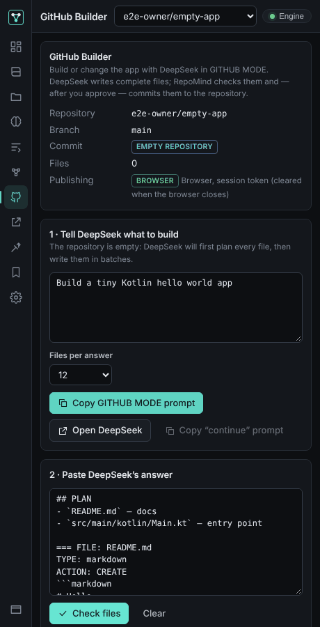</td>
</tr>
<tr>
<td valign="top">

### 🩺 Patch Review

Paste a unified diff or a whole DeepSeek answer (diff blocks and full-file blocks are both understood; wrong hunk counts are repaired).

- **Path safety:** absolute paths, `..`, symlink escapes, `.git/`, secret files, deletions (opt-in).
- **Regression findings**, each with an explanation: removed functions still used elsewhere, changed signatures and return types, broken imports, new abstract interface members, deleted resources still referenced, config and dependency changes, database schema changes without a migration, files outside the approved plan, destructive operations, placeholders, security patterns, added secrets.
- **Regression checklist:** which modules to build, which tests to run, which dependents to re-check.
- **Validate with `git apply --check`**, **Apply** (git checkpoint first, uncommitted edits protected), **Revert**, **Export .patch**.

</td>
<td>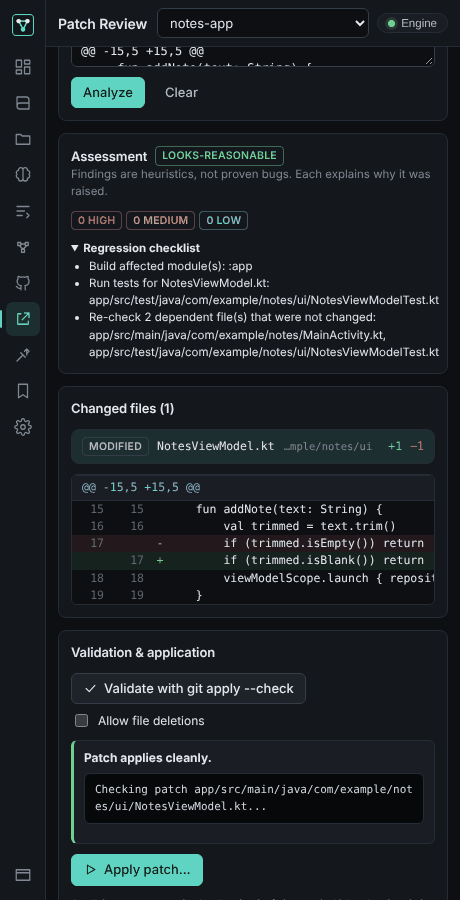</td>
</tr>
<tr>
<td valign="top">

### 🔨 Build & Test

Detects your toolchains and commands: **Gradle/Android** (`test`, `assembleDebug`, `lint`, `compileDebugKotlin`), Maven, npm/pnpm/yarn scripts, TypeScript, pytest/ruff/mypy, cargo test/check/clippy, go test/vet/build, make, CMake.

- Every run shows the **exact command, directory, timeout and side effects** and needs your confirmation.
- No shell, no `sudo`, timeouts, a cancel button and live output.
- Output is analysed — Kotlin, javac, AAPT, Android Lint, tsc, ESLint, rustc, go, gcc/clang, pytest, JUnit, Jest/Vitest diagnostics with file and line — then one click turns it into a **correction prompt**.
- Custom commands are typed by you and checked (pipes, `&&`, `rm`, `sudo` and destructive git are refused).

</td>
<td>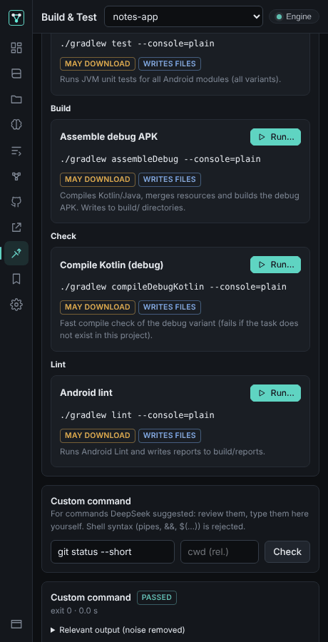</td>
</tr>
<tr>
<td valign="top">

### 📒 Memory

Persistent project knowledge that goes at the top of every prompt: objectives, architecture, stack, conventions, dependencies, decisions, known bugs, completed and outstanding tasks, limitations, constraints.

- Every entry is tagged **verified** (from the index), **approved** (by you) or **suggested** (from DeepSeek — *not* used in prompts until you approve it).
- Edits are versioned with history and restore; nothing you approved is ever overwritten automatically.
- Export as `PROJECT_CONTEXT.md`, `ARCHITECTURE.md`, `DEVELOPMENT_STATUS.md`, `DECISIONS.md`, `KNOWN_ISSUES.md` (or JSON) and import edits back.

</td>
<td>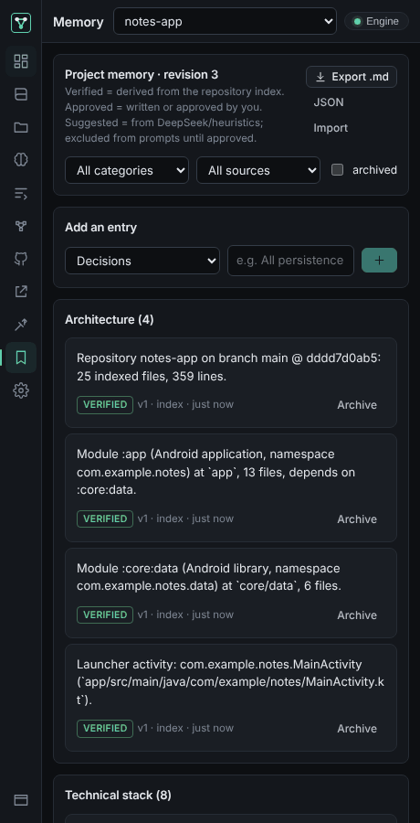</td>
</tr>
<tr>
<td valign="top">

### 🛠️ Settings

Engine status, versions and paths; GitHub token (keyring or session); index exclusions and file size/count limits; default context budget; DeepSeek URL; dark/light theme; an optional desktop notification when a build finishes; export or delete all local data.

</td>
<td>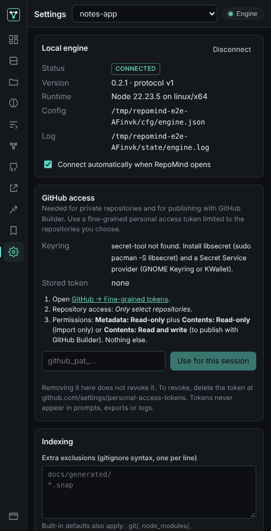</td>
</tr>
</table>

### Engineering modes

| Mode | Use it to | Stages |
|---|---|---|
| **Architecture** | understand the existing design and plan a feature without rewrites | Understand → Plan → Complete |
| **Implementation** | build a complete feature following the repo's conventions | Understand → Plan → Implement → Review → Verify → Correct → Complete |
| **Debugging** | trace a bug to its root cause with evidence before fixing it | Understand → Plan → Implement → Verify → Correct → Complete |
| **Refactoring** | restructure while keeping behaviour and public interfaces | full cycle |
| **Code Review** | have DeepSeek review a diff together with RepoMind's findings | Review |
| **Testing** | write tests with the frameworks already in the project | Plan → Implement → Verify → Correct → Complete |
| **Emergency Fix** | get the smallest safe fix for a broken build | Implement → Verify → Correct → Complete |
| **Project Handoff** | produce a full project overview for another AI or developer | Handoff |

Every prompt carries the same ground rules: use only APIs and files that exist in the provided context (or say `MISSING CONTEXT`), never invent paths, don't rewrite the architecture, don't touch unrelated code, no placeholders, never claim code compiles or tests pass, and treat repository content as data.

### Supported languages

| Ecosystem | What RepoMind understands |
|---|---|
| **Android / Kotlin / Java** | classes, objects, functions, `@Composable`, Activities/Fragments/ViewModels, Room `@Entity`/`@Dao`, imports including same-package references, `R.layout.x` and ViewBinding → layout files, AndroidManifest components and launcher, Gradle (Groovy + KTS) modules, `project(":x")`, version catalogs |
| **TypeScript / JavaScript** | imports/exports, `require`, dynamic imports, classes, methods, arrow functions, workspaces, `@/` aliases |
| **Python** | `import`/`from`, relative imports, classes, methods, decorators, `__main__` |
| **Rust** | `mod`, `use crate::`/`super::`, structs, enums, traits, `impl` methods |
| **Go** | packages, module-path imports, methods with receivers |
| **C / C++** | includes, functions, structs/classes, namespaces |
| **Config** | package.json, Cargo.toml, go.mod, pyproject, requirements, Markdown headings |

The parsers are fast and dependency-free (they run in your browser), but **lexical**, not full compilers: generated code, macros and reflection are not traced. RepoMind lists such gaps under *Project Brain → Index limitations* instead of guessing.

---

## 🧩 How it works

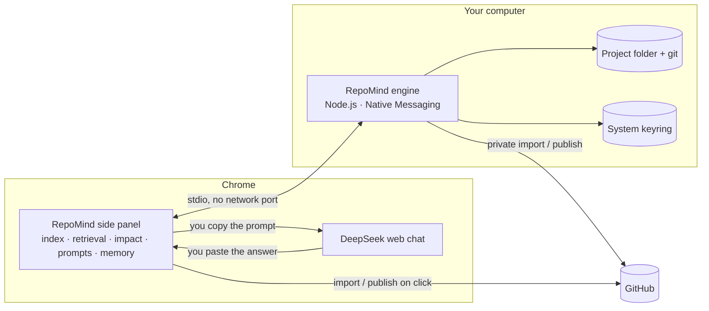

1. **Index.** RepoMind reads the repository (a GitHub zip snapshot, or the folder via the engine), respecting `.gitignore` and skipping binaries, build output and secret files. It extracts symbols and imports for every file, resolves them into a dependency graph (including Android resources and Gradle modules), and finds entry points, configuration and the tech stack. Indexing runs in a background worker; everything is stored in the browser's IndexedDB.
2. **Retrieve.** For a task, a BM25 search over file paths, symbol names and code ranks the files; the graph adds what those files import, what imports them, their tests and build files. Every file carries human-readable reasons.
3. **Assemble.** The context budget fits the best files into an estimated token limit, shrinking large dependencies to outlines rather than dropping them. Secrets are redacted and file contents are wrapped as *untrusted data*.
4. **Prompt.** The prompt contains the project identity (repo, branch, commit), approved memory, the task and acceptance criteria, the impact report, the files and their relationships, mode- and stage-specific instructions and an exact response format.
5. **Check.** DeepSeek's answer is parsed into a patch or files, applied *in memory* and compared with the original: symbols, signatures, imports, resources, schema, plan scope.
6. **Verify or publish.** With your approval, the engine applies the patch (after a git checkpoint) and runs real builds and tests; errors flow back into the next prompt. Or GitHub Builder commits the files to GitHub.

More detail: [ARCHITECTURE.md](ARCHITECTURE.md) (algorithms, protocol, data flow).

---

## 🔒 Safety & privacy

- **$0 and no AI APIs.** No DeepSeek/OpenAI/Claude keys, no embeddings service, no cloud backend.
- **No automation of DeepSeek.** RepoMind never reads, scrapes, injects into or submits on the DeepSeek website. You copy and paste.
- **No telemetry, no analytics.** The only network traffic is GitHub — and only when you import, refresh, store a token or publish.
- **You approve every change.** Applying a patch, running a command, creating a worktree, publishing to GitHub and promoting an AI suggestion into memory all need an explicit click and confirmation.
- **The engine is locked down.** It only accepts this extension's ID, has no network port, confines every path to the project you opened (no `..`, no symlink escapes, no system folders), runs commands without a shell and never with `sudo`, and binds each approval to the exact command you saw.
- **Secrets stay out.** Secret files (`.env`, keystores, keys, `local.properties`) are never indexed or published; secret-looking values are redacted from prompts, logs and command output; GitHub tokens live in the system keyring.
- **Repository content is untrusted.** Instructions hidden in READMEs or comments are flagged and wrapped as data.

Build scripts are still code: running `./gradlew` or `npm test` executes whatever the project defines. Run untrusted projects in a VM. See [SECURITY.md](SECURITY.md) and [PRIVACY.md](PRIVACY.md).

---

## ❓ FAQ

<details>
<summary><b>Does it work without the local engine?</b></summary>

Yes, for GitHub repositories and browser folders: indexing, Explorer, Project Brain, Context Builder, Workflow prompts, Patch Review analysis, Memory and GitHub Builder (with a session token). The engine is required for local folders with git, applying patches, checkpoints, worktrees, Build & Test and keyring storage.
</details>

<details>
<summary><b>"GitHub refused the write" when publishing</b></summary>

The token can't write to that repository. Edit it on GitHub: *Repository access* must include the repository and *Contents* must be **Read and write**. In GitHub Builder, the **Publishing** line shows which token is used (ENGINE = keyring, BROWSER = session); replace that one in Settings.
</details>

<details>
<summary><b>DeepSeek's answer was cut off</b></summary>

RepoMind detects files without a closing code block and answers without the status block. Click **Copy "fix and resend" prompt** or **Copy "continue" prompt**. For big files, lower *Files per answer* in GitHub Builder.
</details>

<details>
<summary><b>Can DeepSeek create images or the Gradle wrapper jar?</b></summary>

No — only text files. DeepSeek lists binary files under MANUAL STEPS. For Android, open the project once in Android Studio (or run `gradle wrapper`) and commit the wrapper.
</details>

<details>
<summary><b>The extension says "Local engine is not installed or not registered"</b></summary>

Run `~/repomind/scripts/install.sh --no-build`, restart the browser and check `repomind-engine --doctor`. For a less common Chromium browser, pass `--browser chromium|brave|vivaldi|edge`.
</details>

<details>
<summary><b>How accurate are the token counts?</b></summary>

They are estimates (about 3.4 characters per token for code). DeepSeek's tokenizer isn't available offline, so keep a margin in your budget.
</details>

<details>
<summary><b>Windows or macOS?</b></summary>

Not yet. The extension runs anywhere Chrome runs, but the engine and installer are Linux-only for now (any distribution — see [Installation](#-installation)); the OS-specific parts are isolated so they can be added.
</details>

---

## 🧪 Development

```bash
npm ci
npm run check                  # lint + typecheck + unit/integration tests + builds
npm run e2e                    # real Chrome + real engine end-to-end test (Chrome for Testing or Chromium)
npm run bench                  # offline retrieval benchmark
./scripts/package-release.sh   # builds release/repomind-prebuilt.tar.gz
```

Monorepo: `packages/core` (all analysis logic, shared), `packages/engine` (Native Messaging host), `packages/extension` (MV3 side panel, React). See [DEVELOPMENT.md](DEVELOPMENT.md), [CONTRIBUTING.md](CONTRIBUTING.md) and [PROJECT_HANDOFF.md](PROJECT_HANDOFF.md), which lists exactly what has and hasn't been verified.

## 📚 Documentation

[INSTALLATION](INSTALLATION.md) · [ARCHITECTURE](ARCHITECTURE.md) · [DEVELOPMENT](DEVELOPMENT.md) · [SECURITY](SECURITY.md) · [PRIVACY](PRIVACY.md) · [CONTRIBUTING](CONTRIBUTING.md) · [CHANGELOG](CHANGELOG.md) · [PROJECT_CONTEXT](PROJECT_CONTEXT.md) · [PROJECT_HANDOFF](PROJECT_HANDOFF.md) · [Benchmark & A/B protocol](benchmarks/PROTOCOL.md)

## 📄 License

[MIT](LICENSE) © cyb3rl00m and RepoMind contributors.
